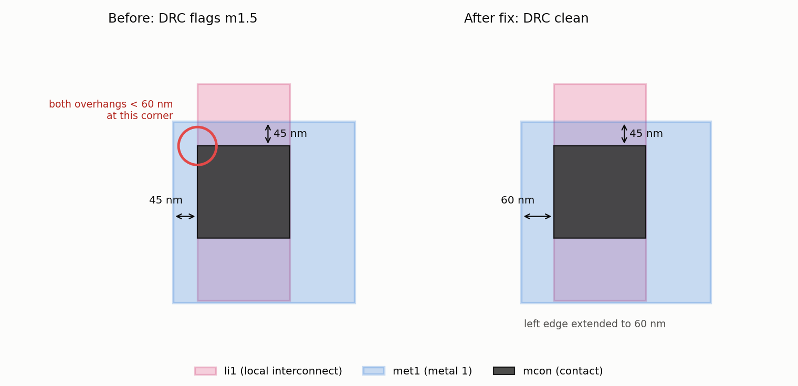

# drcagent: an LLM agent for DRC triage and repair

`drcagent` is an AI agent for **physical verification** on the open-source SkyWater **sky130** 130 nm process. It reads a design-rule-check (DRC) report, looks each rule up in the official foundry documentation, inspects the layout around each violation, edits the layout to fix it, and **re-runs the real DRC deck to verify its own fix** before it writes a plain-English report.

The project also measures whether the agent is worth using. It ships a benchmark of layouts whose violations are **verified by the real DRC tool**, and a hand-written rule-based fixer as the baseline the agent has to beat.



*Example: the sky130 rule m1.5 requires metal 1 to overhang a contact by at least 60 nm on two adjacent sides. At the circled corner, both sides overhang by only 45 nm. Extending one edge to 60 nm clears it, and DRC confirms the fix.*

## How it works

```
layout (GDS) ──► KLayout + sky130 DRC deck (181 checks) ──► violation report
                                                               │
          ┌──────────────────── agent tool loop ───────────────┘
          │  run_drc · list_violations · lookup_rule / search_rules (RAG over the foundry docs)
          │  inspect_layout · resize_shape / move_shape · run_drc (verify) · submit_report
          ▼
fixed layout + report ──► scored by re-running DRC independently (never by the agent's own claim)
```

| Part | File | What it does |
|---|---|---|
| DRC runner | `drc.py` | Runs `sky130A_mr.drc`, the open-source KLayout deck used to check real sky130 shuttle tape-outs, and parses the `.lyrdb` report, including the measured distance on each marker. |
| Rule knowledge base | `rules_kb.py` | Searches 883 rule entries using BM25: every periphery rule table in the official SkyWater documentation, plus every check description in the deck. Rule IDs are matched exactly, and synonyms are mapped ("local interconnect" → `li`). |
| Layout tools | `layout.py`, `tools.py` | Query shapes near a point, and resize or move editable shapes on the 5 nm grid. Foundry standard cells are **read-only**, and shapes **cannot be deleted**, so a fix can't cheat by removing the problem. |
| Agent | `agent.py`, `llm.py` | A provider-agnostic tool-use loop with a CPV-assistant system prompt. It runs on **Claude** (Anthropic API, with prompt caching), **Gemini** (Google's google-genai SDK, which has a free tier) or any OpenAI-compatible API, so different models can be compared on the same benchmark. Every action goes through the tools. |
| Baseline | `baseline.py` | The script a CAD engineer would write: it classifies each rule from its description (width, spacing, area, enclosure) and applies a hard-coded minimal fix. It uses no LLM. |
| Benchmark | `inject.py` | Builds layouts from real `sky130_fd_sc_hd` cells, injects known violations, and **keeps a case only if the real deck flags exactly the intended rules**. |
| Evaluation | `evaluate.py` | Measures the clean rate, edit count, metal area changed against the minimal fix, and, for the agent, rule recall, false "verified clean" claims, steps and tokens. |

## Benchmark

| Split | Cases | Violations | Rule types | Purpose |
|---|---:|---:|---|---|
| `benchmark/` | 40 | 65 | 12: width, spacing and area on li1, poly, met1 and met2, plus `m1.5` contact enclosure | The rules the baseline was written for |
| `benchmark_heldout/` | 15 | 26 | 3: `via.4a`, `m2.4` (via enclosure) and `ct.2` (contact spacing) | Rules the baseline has **never seen** |

All 55 layouts passed tool verification with 0 rejected attempts. Building the benchmark exposed one subtlety. `m1.5` fires only when **both** edges at one corner of a contact are short, so an injection with a single short side is legal and produces no violation. A rule-reading agent has to catch the same detail.

## Results

Every result is re-verified by running the real DRC deck on the output layout.

| Method | Split | Clean layouts | Edits per violation | Metal area changed vs minimal fix |
|---|---|---:|---:|---:|
| Rule-based baseline | main (65 violations) | **40 / 40** | 1.00 | 1.88 vs 1.76 µm² (+7%) |
| Rule-based baseline | held-out (26 violations) | **0 / 15** | 0 | n/a: rules not handled |
| LLM agent (Gemini) | held-out | *run it, see below* | | |
| LLM agent (Claude) | held-out | *run it, see below* | | |

**What this setup tests.** On rules someone has already scripted, a deterministic fixer is perfect, essentially free, and hard to beat. The open question is the long tail. Real decks have hundreds of rules, and a script only handles the ones someone coded. The held-out split measures whether the agent can fix rules nobody wrote code for, using only the documentation and the geometry, and what that costs in tokens and time.

## Usage

```bash
# 1. KLayout (the DRC engine): apt install klayout | brew install --cask klayout | klayout.de
#    On macOS/Windows, point KLAYOUT_BIN at the klayout executable if it is not on PATH.
pip install -e ".[dev]"
bash scripts/fetch_pdk.sh          # sparse-clones the sky130 deck, rule docs and cells (~15 MB)
pytest -q                          # 36 tests, including the agent loop with a scripted model

# 2. Baseline (no API key needed)
python -m drcagent eval --method baseline --bench benchmark
python -m drcagent eval --method baseline --bench benchmark_heldout

# 3a. Agent on Gemini (free key from aistudio.google.com; set GEMINI_API_KEY)
python -m drcagent models --provider gemini                     # pick a model your key can use
python -m drcagent eval --method agent --provider gemini --model <model> --bench benchmark_heldout --limit 3 -v
python -m drcagent eval --method agent --provider gemini --model <model> --bench benchmark_heldout
#     free tiers are rate-limited; requests are paced to 9/min by default (change with --rpm)

# 3b. Agent on Claude (needs ANTHROPIC_API_KEY). Start small to check cost before running everything.
python -m drcagent eval --method agent --bench benchmark_heldout --limit 3 -v
python -m drcagent eval --method agent --bench benchmark_heldout
python -m drcagent eval --method agent --bench benchmark --model claude-haiku-4-5-20251001   # cheaper model comparison

# Fix a single layout
python -m drcagent fix benchmark/case_003.gds -o fixed.gds
```

Each agent run writes `results/agent_<provider>_<split>/results.json` and one `.trace.json` per case, containing every tool call, the report and the edits.

## Testing

- DRC parsing, marker measurement, and the claim that clean cells pass all 181 checks.
- The injectors: each violation type is confirmed by the real deck.
- Layout safety: IDs survive a GDS round trip, foundry shapes are read-only, shapes can't be deleted, and edits snap to the grid.
- Retrieval: every benchmark rule is present in the docs, and free-text queries find the right rule.
- The agent loop end to end with a scripted model, and again through the real Anthropic, Google GenAI and OpenAI SDKs against mock servers.
- Feasibility: a held-out `ct.2` case can be fixed with the agent's tools.

## Limitations

- Violations are **synthetic**: rectangles injected into free space next to real cells. Real DRC triage involves hierarchy, waivers, and thousands of markers that share one root cause.
- Fixes are checked by DRC only, not LVS. Moving a shape could break a connection in a real design.
- Only rectangle edits are supported. There are no polygons, jogs or new shapes.

## Next steps

1. Run the agent on real violations from an OpenLane sky130 design instead of injected ones.
2. **Cluster markers before triage**, so that one root cause behind 500 markers costs one investigation.
3. Add an LVS check so the scoring also catches fixes that change connectivity.
4. Compare models (Claude vs Gemini) and prompts on accuracy per dollar.

## Licences

This code is released under the MIT licence. The sky130 PDK files (Apache-2.0) and the KLayout DRC deck (GPL-3.0) are fetched by `scripts/fetch_pdk.sh` and are not included in this repository.
